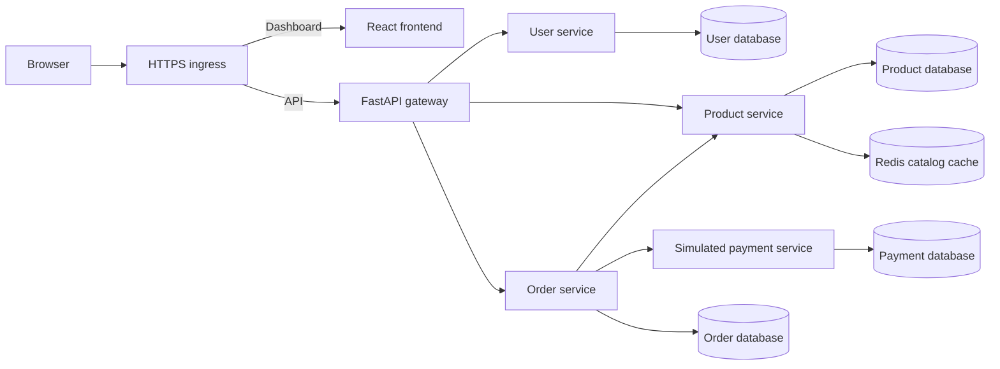
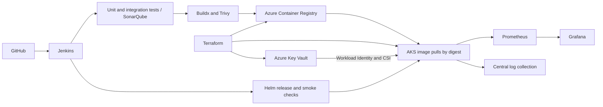

# Architecture

The monorepo will build six independently versioned images and deploy six Helm releases. Each FastAPI service publishes its own OpenAPI schema and Swagger UI in development. The gateway is the browser's API entry point. The frontend serves the React dashboard. Kubernetes routes HTTPS paths from one origin, with internal services reachable through ClusterIP.

| Component | Planned API and ownership |
| --- | --- |
| User | Register and authenticate users, issue short-lived signed access tokens, expose public verification keys |
| Product | Browse the catalog, quote prices, and manage expiring inventory reservations |
| Order | Create orders and list a customer's orders, own checkout state and price snapshots |
| Payment | Produce deterministic simulated approval or decline, persist outcomes by order and attempt ID |
| Gateway | Route versioned API calls, verify tokens, and propagate request IDs |
| Frontend | Browse products, sign in, check out, and view order history |

Use separate PostgreSQL databases and least-privilege roles, initially on one local instance. Redis accelerates catalog reads with bounded TTLs. PostgreSQL remains authoritative for stock. Orders persist an idempotency key per customer and a checkout state before requesting inventory or payment. Calls carry stable operation IDs. On timeouts, reconcile the outcome by operation ID before retrying or releasing inventory. Define replay, expiry, and compensation behavior in contract tests. The simulator accepts scenario inputs without collecting card data.

Protected services verify identity and enforce resource ownership. Reserve inventory and simulate payments through internal endpoints restricted by workload identity or service authentication and NetworkPolicy. Return uniform error responses with correlation IDs. Expose liveness, readiness, and internal Prometheus metrics. Keep dependency checks in readiness and keep liveness focused on process health.

## Deployment decisions

- Use Docker Compose for local development. Test Kubernetes NetworkPolicy with an enforcing local CNI. Use an explicit metrics provider to verify HPA behavior.
- Evaluate AKS Automatic first. Plan Azure CNI Overlay with Cilium, Entra authentication, OIDC and Workload Identity, and Key Vault CSI mounts. Choose the API endpoint model alongside Jenkins connectivity before creating a cluster. Confirm region, availability, address ranges, registry permissions, and estimated costs in the Azure phase. [AKS Automatic](https://learn.microsoft.com/en-us/azure/aks/intro-aks-automatic) · [ACR integration](https://learn.microsoft.com/en-us/azure/aks/cluster-container-registry-integration)
- Use per-service identities, default-deny ingress and egress, and explicit allowances for DNS, ingress, metrics, and service dependencies. Deploy using a namespace-scoped Jenkins identity. Keep runtime secrets in ignored local files or Azure Key Vault.
- Use startup, readiness, and liveness probes, resource requests and limits, HPA, and rolling updates. Use Helm readiness and smoke checks to restore a previous release on failure. Keep database migrations backward-compatible across the rollback window.
- Export metrics to Prometheus and structured stdout logs to a central collector. Plan Loki locally and Azure Monitor for AKS after cost review. Use Grafana to display request rates, errors, latency, and workload health. Exclude credentials and personal data from telemetry.
